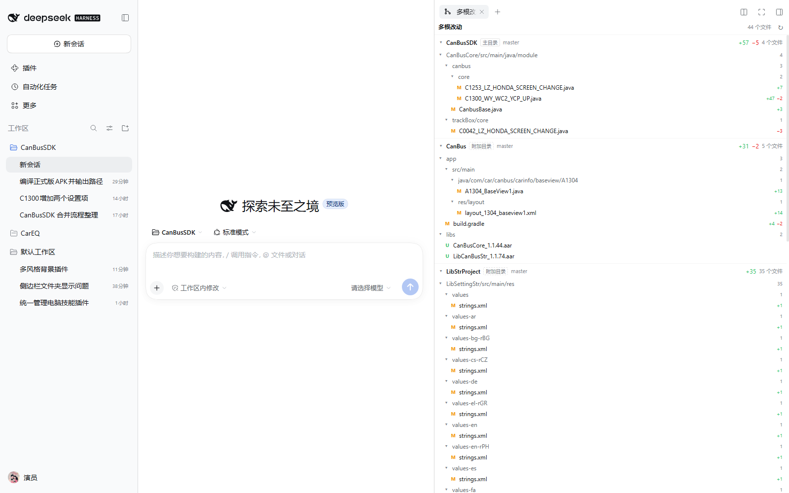
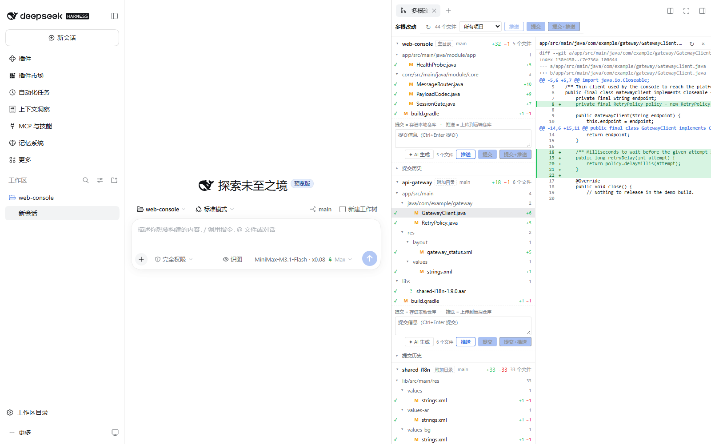
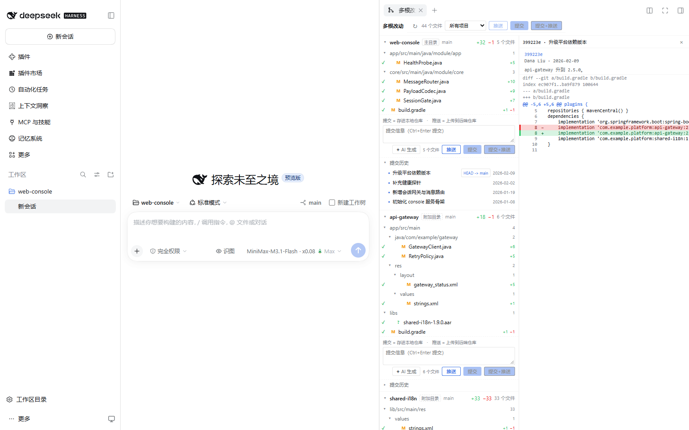

# dsh-multi-root-changes

给 DeepSeek Harness 的侧栏加一个 **多根改动** 页签：一个面板里同时看到会话主工作目录
**以及所有已登记的附加工作目录**的 Git 改动与提交历史。



## 它解决什么问题

DSH 自带的「Git / 文件变动」面板按 **会话工作目录向下扫描** 来找仓库。但很多项目的实际结构是
**若干个平级仓库**：

```text
D:\dev\demo-platform\
  web-console\      ← 会话主目录（Git 仓库）
  api-gateway\      ← 同级（Git 仓库）
  shared-i18n\      ← 同级（Git 仓库）
```

`api-gateway`、`shared-i18n` 都不在 `web-console` 下面，所以自带面板永远扫描不到它们 ——
哪怕你已经用 `@dsh-electron/dsh-plugin-multi-root-workspace` 把它们登记成了附加根，
Agent 能读写它们，**但你仍然只能在面板里看到主仓库的改动**。

本插件就是补上这一块：读取多根注册表，对主根与每个附加根各跑一次只读的 `git status`，
在一个页签里分组展示。实测同一会话：

| 目录 | 类型 | 改动文件 |
| --- | --- | --- |
| web-console | 主目录 | 5 |
| api-gateway | 附加目录 | 6 |
| shared-i18n | 附加目录 | 33 |
| **合计** | | **44** |

## 功能

- **按根分组**：主目录 + 每个附加目录各一节，显示目录名、分支、ahead/behind、增删行数、文件数。
- **左右分栏**：打开文件或提交时，列表在左、预览在右并排显示（不是上下堆叠），
  这样在侧栏这种窄列里文件树仍然可读。

  

- **提交、推送与 AI 生成**：每个仓库（不论当前是否干净）都带一个操作框——写信息，
  或点 `✦ AI 生成` 让模型根据当前改动起草一条提交信息，再点「提交」；旁边就是「推送」。
  提交只针对**该目录你看到的那些文件**，用 `git add -- <files>` + `git commit -- <files>`，
  绝不用 `git add -A`。推送把当前分支发到它跟踪的远端，成功后面板**主动重读状态、
  并让提交历史重新拉取最新的 log**（见下）。
  - **提交（Commit）＝存进本机仓库**：只写本地 `.git`，不联网。改完代码点它。
  - **推送（Push）＝上传到远端**：唯一联网的动作，把本地已有的提交发到远端仓库。
    提交完如果还没上传，点它。
  - 操作框里有一行常驻提示写明这个区别；仓库标题上的 `↑N` / `↓N` 悬停也会说明
    `N` 个本地提交待推送 / `N` 个远端提交待拉取。
- **每个目录的提交历史**：每节下方可展开该仓库自己的最近 30 条提交
  （短 hash、作者、相对时间、`HEAD -> master` 之类的 ref 徽章），
  点任意一条看该提交的 patch。三个平级仓库各看各的历史，互不混用。
  每次提交或推送成功后历史会自动刷新并展开到最新。

  

- **目录树折叠**：改动路径按 VS Code SCM 的方式折成目录树，单链目录压缩成一行（`a/b/c`）。
- **行级 diff**：点任意文件读该文件的 unified diff（含 hunk 头与 +/- 行号）。
- **重命名**：porcelain v2 的 `2` 记录带 `origPath`，显示为 `旧 → 新`，两侧路径都进 pathspec。
- **新文件**：未跟踪文件按「全文新增」渲染；二进制（含 NUL 字节）显示为「二进制文件 · N KB」而不是乱码。
- **冲突**：`u` 记录单独标红。
- **不误判**：`rev-parse --show-toplevel` 与登记路径不一致时，标为「该目录属于另一个仓库」，
  绝不把父仓库的改动算到这个目录头上。
- **实心底色**：面板自己画不透明的 layer-1 底色并建立独立层叠上下文。
  主题类插件（如 dsh-background-studio 的毛玻璃）会把 `--dsw-alias-bg-base` 改成 transparent，
  面板若跟着透明，后面的对话就会透出来、全屏时叠成错位 —— 这里专门避免那种情况。
- **跟随会话**：主根由宿主按 `sessionId` 解析（不是客户端传来的陈旧 cwd），
  切换会话/工作区时面板自动跟随。
- **省电**：页签不可见时停止轮询（宿主会保留已访问页签的挂载，不门控就会一直空转）。

## 安装

```sh
dsh plugin --profile desktop add /path/to/dsh-multi-root-changes
```

或用 npm 包名 / 本地目录在**插件 → 添加插件**里安装。

依赖（可选但强烈建议）：

- `dsh-better-sidebar` —— 页签通过它的 `ctx.betterSidebar.registerTab` 注册，落在 DSH 自己的右侧栏里。
- `@dsh-electron/dsh-plugin-multi-root-workspace` —— 附加根的来源；没装时本插件退化为只显示主目录。

装完 **完全退出并重新打开 DeepSeek Harness**（只刷新页面不够：宿主半的路由需要重新加载）。

## 用法

右侧栏点 `+` → **多根改动**（或在页签条里切到它）。

- 顶部是文件总数与刷新按钮。
- 每个目录一节，点标题折叠/展开。
- 操作框：写提交信息（Ctrl+Enter 提交）→ 点「提交」把本目录的改动落成一个**本地**提交；
  点「推送」把当前分支的提交**上传到远端**。两个动作成功后，面板**立刻重读 `/state`
  并让提交历史重新请求 `/log` 且自动展开**，所以 ahead/behind 计数和提交记录都停在最新值。
  操作框第一行常驻提示「提交 = 存进本地仓库 · 推送 = 上传到远端仓库」，两个按钮的
  悬停提示也各自写明会不会联网。
- 每节底部的「提交历史」可展开该仓库自己的最近 30 条提交，点一条看它的 patch。
- 点文件在底部打开 diff，`×` 关闭，`↻` 重读。
- 不可见时自动停止轮询，8 秒一次（可见时）。

## 访问级别与安全

- **读操作**：`status` / `rev-parse` / `log` / `show` / `diff`，不改动任何东西。
- **写操作只有两处**，都按根校验（必须是真实工作树、不能是另一个仓库的子目录）：
  - 「提交」：对你指定的那些文件执行 `git add -- <files>` + `git commit -- <files>`。
    它显式列出路径，**不用 `git add -A`**，也不会把别人已经暂存的内容一并带走。
  - 「推送」：对该根当前分支执行 `git push`（唯一的网络写操作）。用
    `push.default=upstream` 让**已有的跟踪分支**决定去向，首次推送用
    `push.autoSetupRemote=true`（git ≥ 2.37，单一远端时）记下 upstream，旧版 git
    则在「no upstream」时**仅一次**回退到显式 `push --set-upstream <唯一远端> <分支>`。
    **绝不** force push、`--all`、`--tags`、pull、fetch 或改写远端历史；非快进拒绝原样报错。
    `GIT_TERMINAL_PROMPT=0` + `GCM_INTERACTIVE=never` 让缺凭据时快速失败，
    不会弹出面板无法应答的登录窗。游离 HEAD 直接拒绝（没有分支可推）。
- **AI 生成只读**：起草提交信息时只把当前目录的 diff 与文件名喂给模型，不写仓库、不碰凭据
  （由宿主 `ctx.llm` 解析 provider），并且只取 `text-delta`，模型「思考过程」不会混进提交信息。
- 宿主路由挂在页面同源下：`/dsh-multi-root-changes/api/state`、`/diff`、`/log`、`/commit`、
  `/commit-write`、`/suggest-message`、`/push`。
- 提交 hash 在进入命令行前只放行十六进制对象 id，因此不会被当作 flag 或 rev 表达式。

## 已知边界

- 没有暂存区操作（stage/unstage/discard）、没有切换分支。提交框直接提交它列出的改动文件。
- 「推送」只发送当前分支到既有 upstream；不提供指定远端/分支、强制推送、tag 推送、拉取或合并。
  多远端且无 upstream 时会明确报错而不是猜一个；推送不会自动提交未落盘的改动。
- 没有完整的提交图（泳道连线），只有线性列表与单提交 patch；分支树/合并/变基等操作用 better-sidebar 自带的 Git 页签。
- 合并提交不显示 patch（git 本身也要 `-m` 才有单一差异），只显示它的元数据与父提交数。
- AI 生成需要本机已配置可用的模型路由（与对话页用的是同一套）；没配置时会明确报出原因而不是静默失败。
- 附加根里若登记的是**另一个仓库的子目录**，会被判为「属于另一个仓库」而不是独立仓库（有意的，避免把父仓库的改动记到子目录上）。
- 单文件 diff 上限 2 MiB、未跟踪文件预览上限 1 MiB、单根条目上限 3000、每根提交上限 30 条；超出会明确提示截断。
- Windows 下经受限 token 启动的进程可能读不到某些路径，此时该目录会显示读取失败原因而不是静默消失。

## 开发与验证

```sh
node --check index.js
node --check client.js
node tests/verify-parsers.mjs       # 工作区改动解析器：合成记录 + 真实仓库（可选）
node tests/verify-commit-log.mjs    # 提交历史解析器：合成记录 + 真实仓库（可选）
node tests/verify-push.mjs          # 推送按钮 + 成功后刷新提交历史的回归验证
```

前两个脚本的「真实仓库」一段由调用方通过环境变量给出，仓库里不写死任何人的目录布局：

```sh
# Windows（分号分隔）
set MRC_TEST_REPOS=D:\dev\demo-platform\web-console;D:\dev\demo-platform\api-gateway
node tests/verify-parsers.mjs

# POSIX（分号或换行分隔）
MRC_TEST_REPOS="/path/to/repo-a;/path/to/repo-b" node tests/verify-parsers.mjs
```

不设这个变量时，脚本只跑合成记录那一段并直接跳过真实仓库，不会失败。

两个脚本都直接对真实仓库跑 git，并用**独立的 oracle** 交叉校验：
`verify-parsers.mjs` 比对条目数（并覆盖重命名、冲突、CJK、空格路径），
`verify-commit-log.mjs` 比对提交条数与 **git 自己的提交顺序**。

GUI 验证脚本（`tests/cdp-*.mjs`）通过 CDP 驱动真实浏览器，断言三个目录都列出、
各自文件数正确、每个目录显示**互不相同**的提交历史、附加根的文件与提交 patch 都能渲染、
面板底色不透明、打开预览后是**左右并排**（比较两个子元素的 bounding rect）、
每个目录都有提交框、控制台零报错。`tests/verify-push.mjs` 静态/运行时检查推送按钮存在、
推送成功后操作框仍在（干净仓库也能推）、以及 `historyTick` 同步触发 `/state` 与 `/log` 刷新。

## 许可证

MIT
